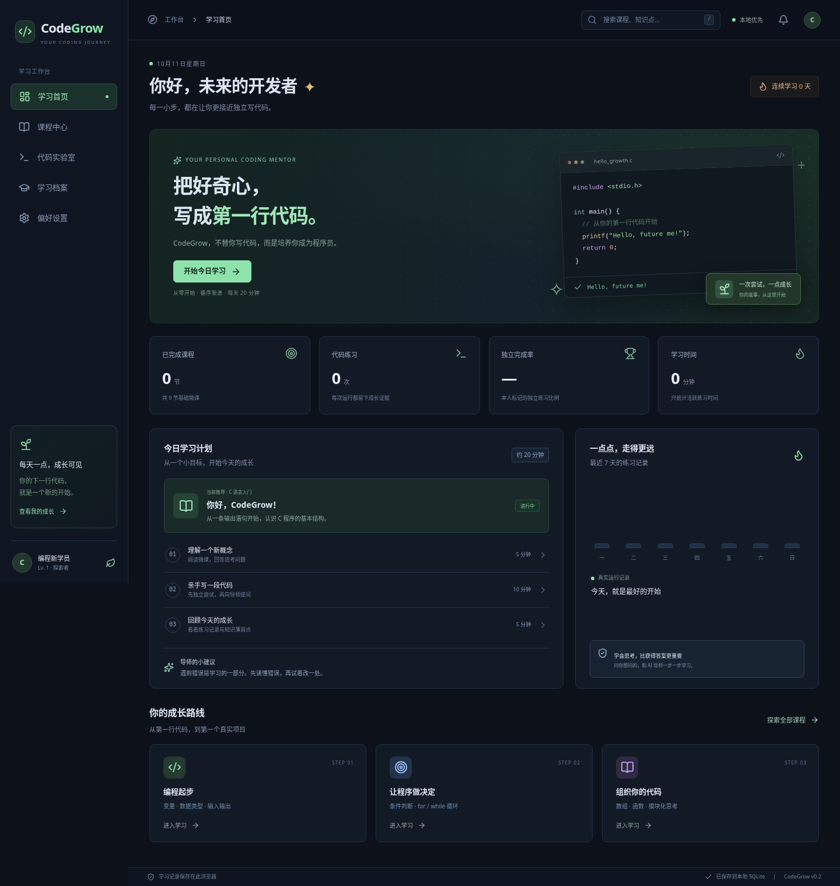
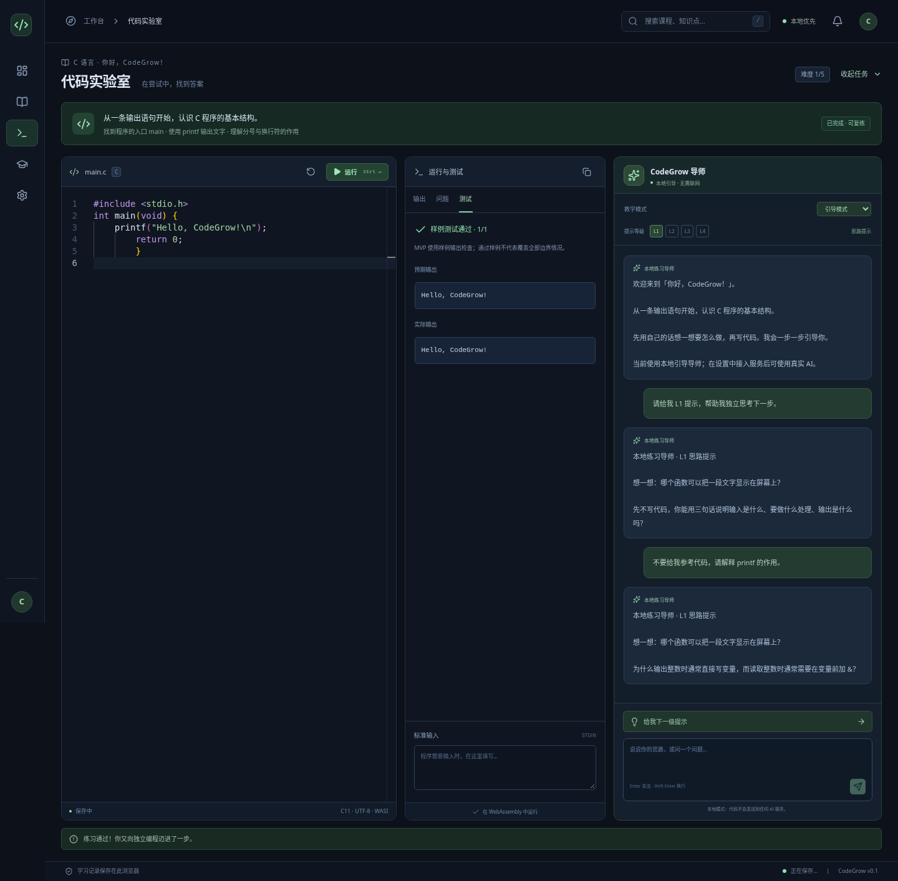

# CodeGrow

> 不替你写代码，而是培养你成为程序员。

CodeGrow 是面向编程零基础大学生的开源编程学习工作台。这个 MVP 是可以在电脑浏览器中打开的 **Web 应用**：React、TypeScript、Monaco、真实 C 编译运行、本地 SQLite 学习记录与自由对话的 AI 私人导师。

项目位于本仓库的 `codegrow/`，原有个人网站继续保留。部署工作流把本应用发布到 GitHub Pages 的 `/codegrow/` 子目录。





## 已实现

v0.3 性能优化：精简按需 Monaco、保留 SHA-256 的编译器缓存恢复与显式提前准备、Worker-only 本地 AI 和按阶段进度／缓存／网络诊断。完整基线、测试结果、Windows 手动验证和边界见 [性能报告](PERFORMANCE.md)。没有改为桌面软件或添加付费服务，学习数据库格式不变。

- 深色 Dashboard：今日计划、真实练习统计、学习路线、课程搜索。
- 11 个 C 语言模块的课程树，9 节可完成的微课与练习。指针、结构体、文件操作标记为后续内容。
- 本地打包的 Monaco Editor：C 语法高亮、草稿保存、`Ctrl + Enter` 运行。
- Clang + LLD + WASI 的真实浏览器编译执行：标准输入、输出、语法错误、取消、运行超时和样例测试。执行器也预留了 C++ 接口；完整 C++ 课程尚未提供。
- SQL.js SQLite 数据库，数据库字节通过 IndexedDB 保存；支持刷新恢复、导出 `.sqlite` 和二次确认重置。
- 学习档案：掌握度估算、本人标记的独立完成率、错误记录、难度建议；兼容旧版提示记录。同源码与输入的重复运行按指纹去重。
- 自然对话导师：先回答你实际提出的问题，再给出建议和具体下一步；允许解释与代码示例，不强制提问或提示等级，也不自动覆盖编辑器。
- **默认免费本地 AI**：WebLLM + Qwen2.5-Coder 7B / 1.5B 的 4-bit 量化模型。你主动下载并启动后，使用浏览器 WebGPU 推理；无需 API 密钥，代码和对话不上传模型服务。
- 成功问答保存到 SQLite，跨课程继续同一对话，最多保留最近 20 轮；模型只读取受上下文容量限制的近期内容。普通提问不自动降低独立完成评分。
- 可选 Node 服务支持 OpenAI 兼容模型 API。未加载模型、缺少服务配置或请求失败时明确报错，不使用预设回答冒充 AI。

## 立即体验

打开 [CodeGrow 网页](https://botongle318-max.github.io/-/codegrow/)，进入「偏好设置」或「代码实验室」，选择本地模型，然后点击「下载并启动本地 AI」。等待显示「本地 AI 已就绪」即可自由提问。

需要最新版 Chrome / Edge、开启硬件加速并支持 WebGPU。RTX 5070 建议先选 7B；显存紧张时选 1.5B。首次下载可能需要数 GB 网络流量；浏览器缓存可复用，但刷新后需要重新加载到显存。免费指没有模型 API 推理费，不代表没有带宽、电力或硬件成本。

下载来源默认 Hugging Face；可主动选择第三方 HF Mirror。没有自动切换、自动下载或后台上传问答。详细硬件、缓存与排错说明见 [免费本地 AI](docs/LOCAL_AI.md)。

## 在 Windows / macOS / Linux 开发

需要 Node.js 24 LTS、npm 和 curl。Windows 10/11 自带 curl；不需要安装 Electron 或本地 GCC。

```bash
cd codegrow
npm ci
npm run prepare:compiler
npm run dev
```

终端会显示本地开发地址，默认端口为 5174。电脑浏览器打开它即可。

`prepare:compiler` 首次通过 HTTPS 下载约 58 MiB 的编译工具并校验固定 SHA-256；再次运行只验证已存在的资源。编译工具不提交进 Git。准备完成后，开发和生产都默认使用同源的 `compiler/` 资源。没有准备时，开发版使用固定 CDN 回退。

## 构建网页

```bash
npm run build:site
npm run preview
```

将 `dist/` 整个目录部署到静态服务器，必须保留 `compiler/` 和 `sql-wasm.wasm`。使用相对资源地址与 Hash 路由，可部署到域名子目录。发布版的核心编辑、课程与执行不依赖外部 AI 服务；首次打开仍需下载站点资源，MVP 暂未实现离线启动的 Service Worker。

## 测试

```bash
npm test
npm run test:server
npx playwright install chromium
npm run build:site
npm run test:e2e
npm run test:database
```

Linux CI 可用 `npx playwright install --with-deps chromium` 安装浏览器依赖。已有 Chromium 时可设置 `CODEGROW_CHROMIUM_PATH`。

生产浏览器测试在独立浏览器上下文与 `/codegrow/` 子目录执行，覆盖真实 C 编译、SQLite 重启恢复、数据导出、错误/超时、自定义输入不计分、重复提交去重、搜索及 1024px 布局；还检查默认本地模型、不会自动下载、连续对话持久化和本人独立声明。测试不会操作用户已有学习数据。

模型生命周期单元测试使用明确标注的 Worker / engine 夹具，云端聊天浏览器测试使用明确的代理响应 fixture，均不代表真实模型质量测试。云端开发环境没有用户的 RTX 5070，未实际下载 7B 权重或验证其推理速度、质量；实际 GPU 推理需要在使用者电脑上启动模型验证。

## 可选云端 AI

参见 [AI 服务配置](docs/AI.md)。将密钥保存在服务端环境变量，启动 `npm run ai:server`，在页面「偏好设置」把「导师运行方式」切换为「自建 AI 代理」，再填写代理地址。前端不会收集 API 密钥。

GitHub Pages 只能托管静态网页，不能运行 Node 服务，但默认本地 AI 不需要服务器。只有选择云端代理时才需要另外部署代理、鉴权、HTTPS 和精确的 CORS 来源。两种运行方式都提供真实模型回复，不会失败后悄悄切换为固定提示。

## 项目结构

```text
src/
  components/        Monaco 与可复用 UI
  data/              版本化课程内容
  pages/             课程、实验室、学习档案、设置
  services/          执行器、SQLite、学习规则、导师适配层与模型 Worker
  stores/            Zustand 导航与会话状态
server/              可选 AI 代理，密钥仅存在服务端
scripts/             本地资源准备
tests/               单元、服务端与浏览器测试
resources/licenses/  第三方许可文本
```

## MVP 的边界

本版使用 C11 / Clang 8.0.1 浏览器工具链，不能调用电脑上的 GCC，也不能访问本机文件。编译/链接各限制 90 秒，程序运行默认 3 秒，WASM 内存上限 64 MiB，输出上限 64 KB。该历史工具链适合基础教学，不承诺现代完整 C++ 标准支持。

练习按课程样例输出检查，通过样例不等于覆盖全部边界，也不证明学生已完全掌握知识。自定义输入、停止与工具环境故障不进入课程评分。掌握度是依据练习、本人独立声明及旧版提示记录计算的可解释估算，不是 AI 的客观诊断；迁移练习、项目模式和完整 C++ 路线留待下一版本。

浏览器本地模型的上下文窗口为 4096 tokens，近期对话、代码和运行结果按保守预算裁剪。较长问题会提示拆分，不会悄悄改写问题；不能承诺完整记住所有历史。AI 回答仍可能出错，请通过编译、测试与自主思考验证。

学习数据属于当前网站地址和浏览器；无痕模式、清除网站数据或浏览器存储回收可能删除记录，建议定期导出。学习时长按 15 秒周期估算活跃时间。

## 开源与发布

CodeGrow 自写源码使用 [MIT](LICENSE)。第三方依赖和编译资源保留各自许可证，见 [THIRD_PARTY_NOTICES](THIRD_PARTY_NOTICES.md)。此许可证不改变仓库中原有个人网站的许可状态。

推送到 `master` 后，仓库的 `Deploy to GitHub Pages` 工作流测试、构建并发布原网站与 CodeGrow。`build` 与 `deploy` 独立：测试通过的网页产物保存在 Actions 的 `github-pages` artifact，部署失败不会丢失产物。

首次发布需仓库管理员打开 [Settings → Pages](https://github.com/botongle318-max/-/settings/pages)，在 **Build and deployment → Source** 选择 **GitHub Actions**，然后在 Actions 重跑失败的部署任务。工作流的默认 `GITHUB_TOKEN` 不能自动首次启用 Pages，不需要为此添加高权限密钥。成功后，CodeGrow 地址为 `https://botongle318-max.github.io/-/codegrow/`；未启用前该地址会返回 404。

若仓库为私有，请在 GitHub 设置中调整为公开，才能公开访问源码；添加许可证本身不会改变仓库可见性。
